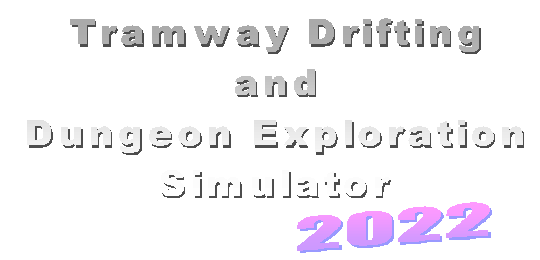
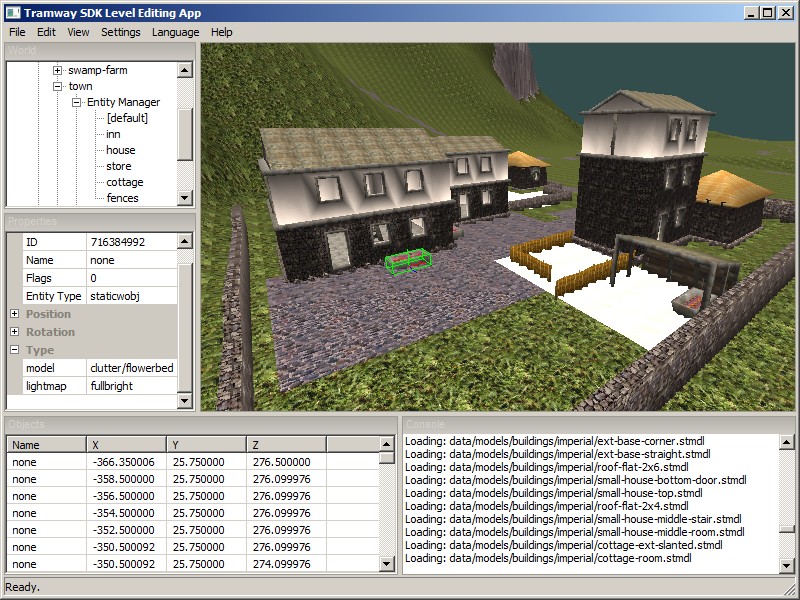
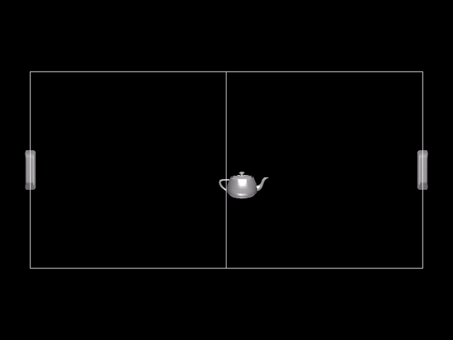

# Tramway Drifting and Dungeon Exploration Simulator 2022 Software Development Kit




It does what Godoesn't.

I am not reinventing the wheel, I am disrupting the wheel industry.

Free func_door included with every install!


## What's it

Software library and tools for making the [Tramway Drifting and Dungeon Exploration Simulator 2022](https://racenis.itch.io/tramway-drifting-and-dungeon-exploration-simulator-2022) and similar applications.

It's meant to work sort of like Quake, GoldSrc or Source engines, but it uses
polygonal soup instead of BSPs and supports level streaming.



## Features
- Polygonal soup graphics
- Non-hierarchical scene ordering
- Ambient lighting
- Lambertian reflection
- Light source attenuation
- Colored lights and surfaces
- Phong illumination
- Point lights
- Warn's lighting for directional lights
- Level streaming
- Allows use of Quake level editors to create level geometry


### Platforms
- Windows (XP SP3 or later)
- Linux
- Web browser (needs WebAssembly support)

### Requirements
- Graphics card (optional) that supports either:
	- OpenGL 4.0
	- WebGL 2.0 (for web builds)
	- Direct3D 9.0
- Decent CPU (at least Pentium 4) if using software rendering
- Mouse and/or keyboard
- Will probably add controllers and other input devices later
- GCC/G++ 12.4.0 or MinGW/G++ 12.4.0
- Clang should work too
- Don't know about MSVC++
- If it supports C++20, it should work
- Python 3.8 for scripts
- Blender 2.83 for 3D model and animation exporters


### Links

More information can be found on the [github.io page](https://racenis.github.io/tram-sdk/). 

#### Demos

- FPS ([source code](https://github.com/racenis/jam-game) / [itch.io](https://racenis.itch.io/dziiviibas-partikula))

- Platformer ([source code](https://github.com/racenis/jam-game-ii) / [itch.io / web demo](https://racenis.itch.io/sulas-glaaze))

- Adventure ([source code](https://github.com/racenis/jam-game-iii) / [itch.io / web demo](https://racenis.itch.io/froggy-garden))

#### Other tools

- [Applets](https://github.com/racenis/tram-applets), i.e. GUI data editors

- [Level editor](https://github.com/racenis/tram-world-editor) for editing worldcells

#### Templates

- [Teapot explorer](https://github.com/racenis/tram-template), main template project

#### Examples

- Pongpot ([source code](https://github.com/racenis/tram-example/tree/main/example-ping-pong))
- ([All examples](https://github.com/racenis/tram-example))



### Building
#### Windows / MinGW
Edit the settings found in `maketool.ini`. Set the platform to WIN32 or WIN64, 
depending on your compiler version.

If you compile dependencies yourself, place them in the `/libraries/binaries/win32`
or `/libraries/binaries/win64` directories.

Set repository root as the working directory.

Run `devtools/maketool.py generate` to generate a `Makefile`.

Use `make library && make clean` to compile the library.

#### Linux / GCC

Install Python interpreter, C++ compiler and OpenGL headers.
```
sudo apt-get install python3
sudo apt-get install build-essential
sudo apt-get install libmesa-dev
```
Install dependencies.
```
sudo apt-get install libglfw3-dev
sudo apt-get install libbullet-dev
sudo pat-get install libopenal-dev
sudo apt-get install liblua5.4-dev
```
These are the packages for Debian-based distributions, for other distributions
check your package manager. 

Download the source code.
```
git clone https://github.com/racenis/tram-sdk.git
```

`vi maketool.ini` or `nano maketool.ini`
Edit the makefile generator's configuration. Set the `compiler` to your `g++`
compiler and `archiver` to your `ar` program. Set `platform` to `LINUX`. Select
the modules which you will be using.

Review the configuration and generate the makefile.
```
chmod +x devtools/maketool.py
devtools/maketool.py config
devtools/maketool.py generate
```

Then compile.
```
make
```

### Dependencies

Header files and binaries (for MinGW x86/x86_64 and WebAssembly) included in `libraries` directory.
Check [/libraries/README.md](/libraries/README.md) for more information.

### Contributions

Due to risks associated with LLM use, we are not accepting code contributions
for the runtime (this repository) part of the project. LLMs and other machine
learning based coding tools exhibit a propensity for emitting code that is
incompatible with the MIT license. Alas, there is no good way to separate genuine
human code from AI slop, ergo we will not be able to accept any code pull
requests for this repository.

However, you can still help by submitting bug reports or suggestions for
improvements.

#### Why not accepting code
Consider this example: you use this framework to create a project. Maybe due to
the platform that you are using, or due to some other requirement you are also
using a third party closed source library.

Later it is determined that a contributor has added GPL licensed code to the
framework. Now you can either release the source code to your project and
violate the third party's license or you keep the source closed and violate the
GPL.

Either way, the outcome is doubleplus ungood.
